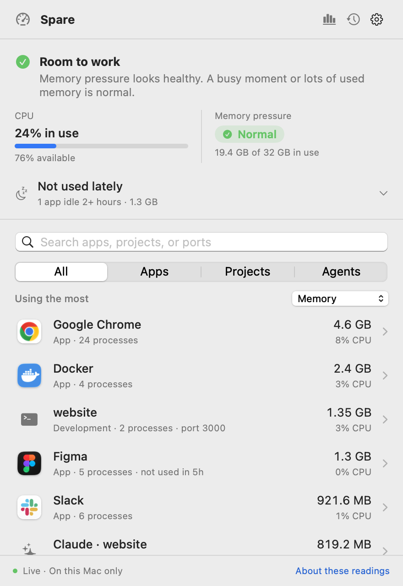

# Spare

**See what's using your Mac.** A free, open-source menu bar app that shows CPU and memory use by the apps, projects, and AI agents you actually recognize, and helps you decide what's safe to close.

[Download Spare 0.13.0](https://github.com/coreyhaines31/spare/releases/download/v0.13.0/Spare-0.13.0-arm64.dmg) · [Website](https://spareformac.com) · [All releases](https://github.com/coreyhaines31/spare/releases)

Free and MIT licensed. No account, no subscription, and nothing leaves your Mac.

<p align="center">
  <picture>
    <source media="(prefers-color-scheme: dark)" srcset="docs/images/spare-dark.png">
    
  </picture>
</p>

## Requirements

- An Apple-silicon Mac (M1 or later). Intel Macs aren't supported.
- macOS 14 Sonoma or later.

## Install

1. [Download the latest DMG](https://github.com/coreyhaines31/spare/releases/latest).
2. Open it and drag **Spare** into your **Applications** folder.
3. Open Spare from Applications or Spotlight. Releases are signed and notarized by Apple; if macOS asks whether you're sure you want to open an app downloaded from the internet, choose **Open**.

Or install with [Homebrew](https://brew.sh):

```sh
brew install --cask coreyhaines31/tap/spare
```

Or without Homebrew, from Terminal:

```sh
curl -fsSL -o /tmp/Spare.dmg "$(curl -fsSL https://api.github.com/repos/coreyhaines31/spare/releases/latest | grep -o 'https://[^"]*-arm64\.dmg' | head -1)" && hdiutil attach -nobrowse -quiet /tmp/Spare.dmg -mountpoint /tmp/spare-dmg && ditto /tmp/spare-dmg/Spare.app /Applications/Spare.app && hdiutil detach -quiet /tmp/spare-dmg && open /Applications/Spare.app
```

### Install with an AI coding agent

Paste this into Claude Code, Codex, or another coding agent:

```text
Install Spare, the free open-source macOS menu bar app from https://github.com/coreyhaines31/spare.
1. Check this Mac is Apple silicon (`uname -m` prints arm64) on macOS 14 or later (`sw_vers -productVersion`). If not, stop and tell me Spare isn't supported.
2. If /Applications/Spare.app already exists, Spare is installed and updates itself; skip to step 5.
3. If Homebrew is installed, run: brew install --cask coreyhaines31/tap/spare
4. Otherwise, download the -arm64.dmg asset from the latest release at https://github.com/coreyhaines31/spare/releases/latest, mount it, copy Spare.app into /Applications, and unmount it.
5. Open Spare with: open /Applications/Spare.app
6. Confirm it's running (pgrep -x Spare), then tell me to look for the gauge icon in my menu bar. Spare has no Dock icon.
```

Spare updates itself. When a new version is out it offers to install it, or you can choose **Check for Updates…** from the gear menu.

## First launch

Spare is a menu bar app, so it has **no Dock icon and no app window by default**. When it opens, look for the gauge icon in the top-right of your menu bar. Spare opens its panel there each time it launches.

- **Click the gauge** any time to open or close Spare.
- **Can't see the icon?** See [Troubleshooting](#troubleshooting). On MacBooks with a notch, a full menu bar can hide it.
- **Prefer a window?** Choose **Open in a window** from the gear menu, or open Spare again from Applications.

The first readings appear within a few seconds. Spare doesn't need any permissions to start monitoring. A few optional features ask for one when you turn them on:

| Feature | Permission | When it's asked |
|---|---|---|
| Warn about sustained pressure | Notifications | When you turn the warning on in the gear menu |
| Launch at login | Login Items | When you turn it on; macOS may ask you to approve it |
| Open Chrome's Task Manager | Accessibility | Only when you click that button; used only to choose that menu item |

## A quick tour

**The overview.** The top shows how hard your Mac is working: CPU in use, with how much is still available, and macOS memory pressure (green Normal, orange Warning, red Critical). Below it, everything using resources is grouped into things you recognize, largest first.

- **Apps** appear with all their helper processes counted together, so Chrome is one line instead of 50.
- **Projects** are local dev servers and tools grouped by folder, with the command and port, like *website · port 3000 · next dev*.
- **Agents** such as Claude Code, Codex, Aider, Ollama, and OpenCode are grouped by the folder they're working in.
- **macOS** processes like WindowServer and kernel_task are labeled with a plain explanation and are never offered for stopping.

Use the filters, search by name, folder, or port, and sort by memory or CPU.

**Hints in the list.** An orange trend arrow means an app's memory keeps climbing. *Not used in 5h* marks apps you've left open but haven't used, and the **Not used lately** section offers to quit them.

**Details.** Click any row to see what it is, what closing it would affect, and its memory history. For browsers and Electron apps, **Inside** breaks the app into tabs and sites, extensions, graphics, and network processes. You can end a single heavy tab or extension process without quitting the whole app. Sessions opened by browser automation show what opened them, and leftover ones can be closed together.

**Closing things.** Spare never closes anything on its own. Every quit or stop shows what it affects and waits for you to confirm. Apps get a normal quit request, so they can ask you to save first.

**Recaps.** The chart button opens the Recap window for Today, This week, or Last 7 days: CPU charts, time under memory pressure, what used the most, and CSV export. History stays on your Mac for up to 30 days and can be paused or cleared.

**While you were away.** Step away for a while and Spare summarizes what ran while you were gone, including which agents and projects are still running.

## Troubleshooting

**I can't find Spare in the menu bar.**
Open Spare again from Applications or Spotlight; it opens its window. If the icon is hidden, your menu bar is probably full. On MacBooks with a notch, icons that don't fit are hidden behind it. Quit a few other menu bar apps, or check your menu bar manager (such as Bartender or Ice) for hidden items.

**The readings say "Getting a feel for your Mac."**
Spare needs two readings to measure CPU, which takes a few seconds after launch or after your Mac wakes.

**Memory pressure says Unavailable.**
macOS didn't report it for that reading. CPU and memory use are still measured; it usually returns on the next reading.

**Why can't I end some processes?**
Rows with a lock are processes the app needs to keep running, such as its graphics or network process, or the app itself. Click the lock to see why. To free that memory, quit the whole app.

**Which Chrome tab is using all that memory?**
Chrome doesn't tell other apps which tab each process runs. Under **Inside Google Chrome**, click **Open Chrome's Task Manager**; it lists every tab with its memory.

**Launch at login doesn't stick.**
macOS may need you to approve it. Choose **Approve in Login Items…** from the gear menu.

**Something else isn't right.**
[Open an issue](https://github.com/coreyhaines31/spare/issues/new/choose) with your macOS version, Spare version (gear menu → Check for Updates… shows it), and what you expected to see.

## Uninstall

1. Choose **Quit Spare** from the gear menu.
2. Drag Spare from Applications to the Trash.
3. Optionally, remove its saved history and settings:
   ```sh
   rm -r ~/Library/Application\ Support/Spare
   defaults delete com.spareformac.Spare
   ```

If you allowed Accessibility for Spare, you can also remove it in System Settings → Privacy & Security → Accessibility.

## Privacy

All monitoring happens on your Mac. Spare has no account, no analytics, and makes no network requests except checking for updates. It never reads tab contents or saves process lists. It reads the launch arguments of your own processes to label them and show commands, but never saves or sends them. Recap history is stored locally at `~/Library/Application Support/Spare/` and can be paused or cleared at any time. The full details are in [How Spare works](docs/how-it-works.md#privacy-in-full).

## Limits

Spare measures CPU and memory. It doesn't monitor GPU, disk, network, temperature, fans, or battery, and it doesn't free or "clean" memory. It can't tell which tab a browser process runs, look inside Docker containers, or measure per-app power use. Readings show what's using resources, not proof of what's causing a slowdown.

## Learn more

- [How Spare works](docs/how-it-works.md): how readings, grouping, recaps, and idle detection are calculated.
- [Contributing](CONTRIBUTING.md): build from source, run the tests, and send a change.
- [spareformac.com](https://spareformac.com): guides, comparisons, and a library of macOS processes.

## License

MIT. See [LICENSE](LICENSE).
